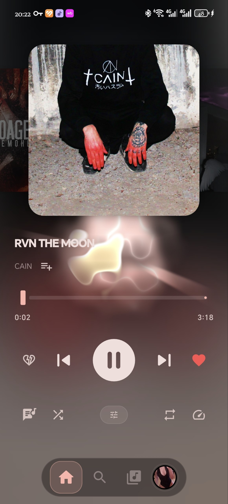
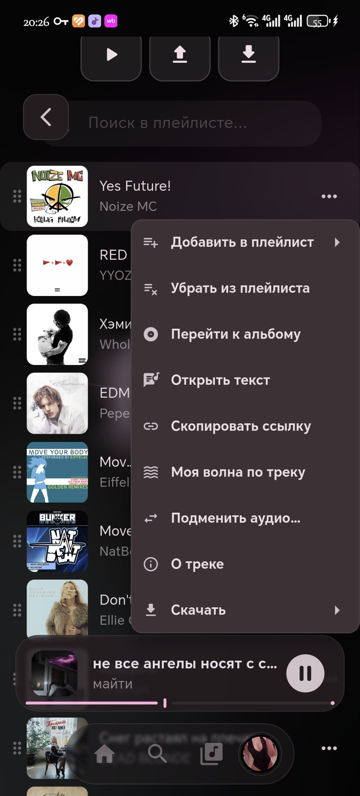
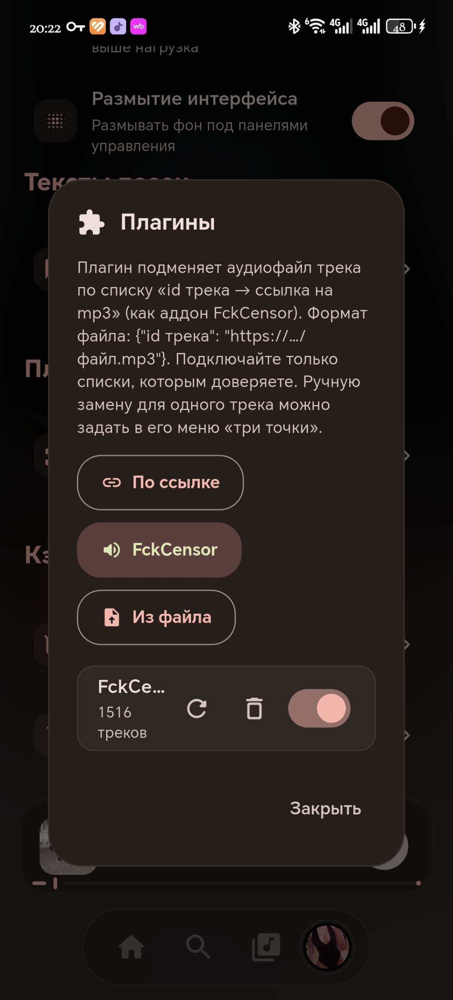

# 🎵 YAYMA — Yet Another Yandex Music App

  <b>Альтернативный, кастомный и стильный клиент Яндекс Музыки с расширенными возможностями и уникальным дизайном.</b>

---

## 📥 Скачать / Релизы

Получить самую свежую скомпилированную версию приложения можно по ссылке ниже:

[📦 **Скачать YAYMA v2.5.2-mod2 (APK)**](https://github.com/Gafykin/YAYMA-android/releases/tag/1)

---

## 📸 Скриншоты интерфейса

   &nbsp;&nbsp;&nbsp;&nbsp;
   &nbsp;&nbsp;&nbsp;&nbsp;
  

*(Примечание: вы можете загрузить ваши изображения в репозиторий в папку `assets/screenshots/` и подставить точные пути вместо заглушек выше).*

---

## ✨ Особенности мода (v2.5.2-mod2)

**Добавлен плагин с обходом цензурных трэков.
**На главном экране стало доступно добавлять трэк прямиков в плэйлист.
**В плэйлисте теперь при включении трэка продолжается плэйлист, а не включается моя волна.
**Добавлена функция замены трэка в плэйлисте и убирания трэка из плэйлиста.

---

## 🛠 Технологии

Проект написан на современном стеке технологий:
* **Flutter** — для создания красивого и отзывчивого пользовательского интерфейса.
* **Rust (Flutter Rust Bridge v2)** — для максимальной производительности, работы с сетью, аудиопотоками и базами данных «под капотом».

---

## 💡 Поддержка и разработка

Если вам нравится проект, вы можете поддержать его звездочкой на GitHub или предложить свои улучшения через Pull Requests!
